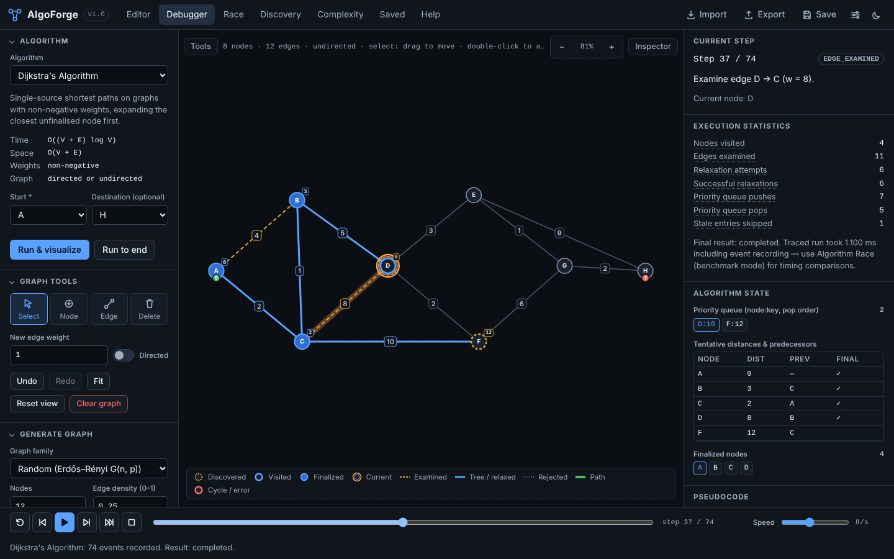
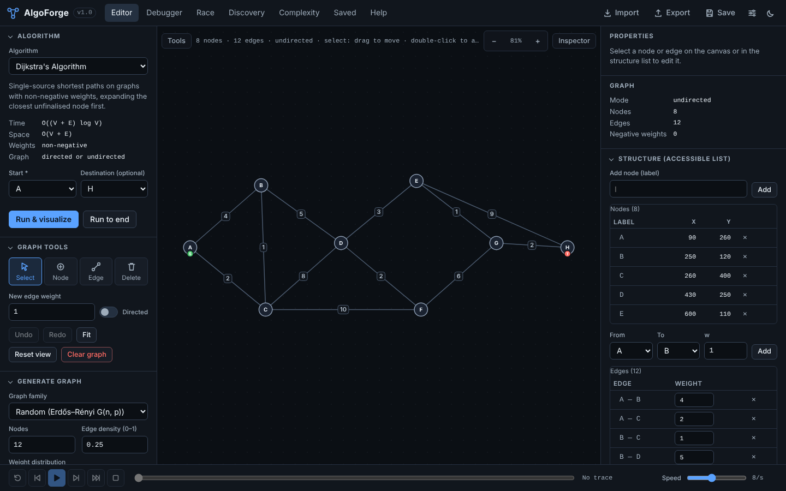
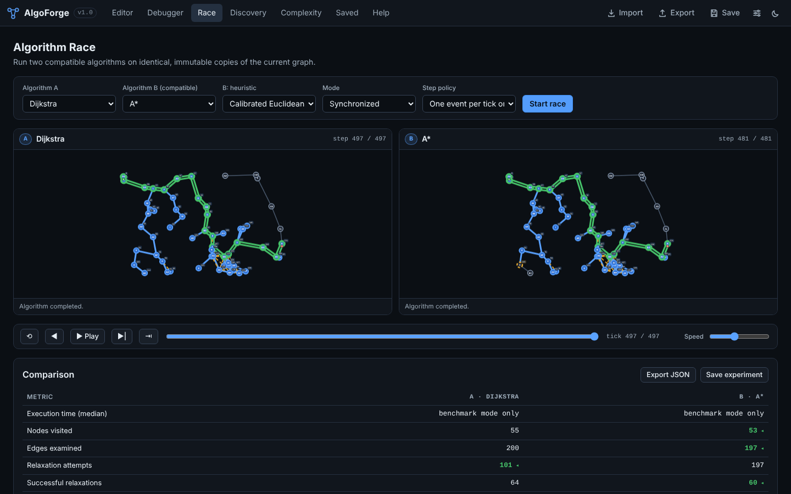
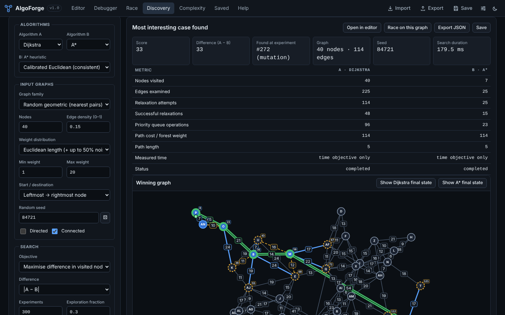
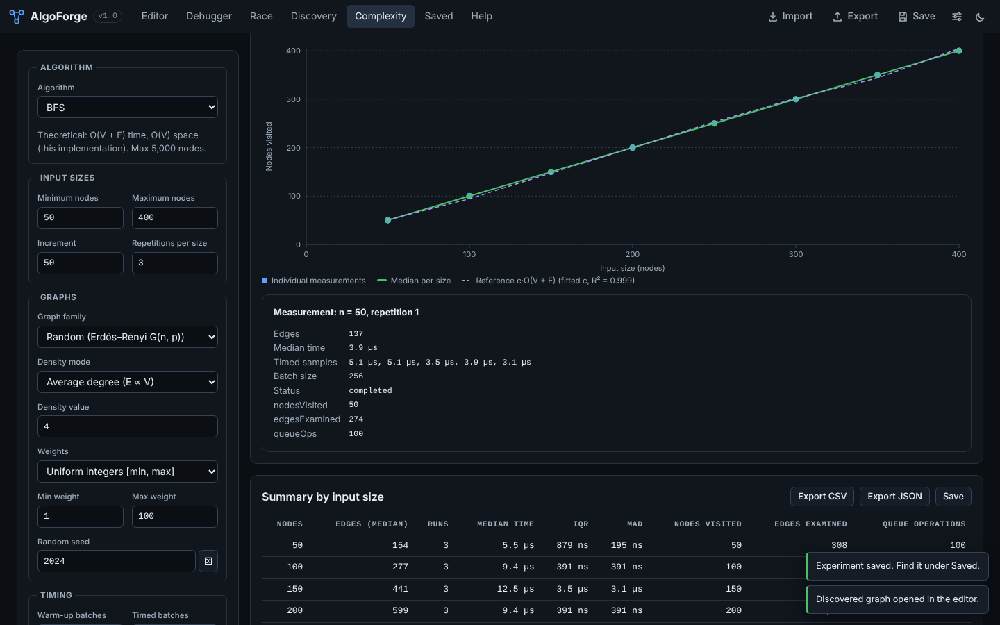

# AlgoForge

[](https://github.com/kannekikun1/AlgoForge/actions/workflows/ci.yml) [](LICENSE)

**An open-source, fully client-side laboratory for exploring, visualizing, benchmarking and stress-testing graph algorithms.**

AlgoForge combines an interactive graph editor, a step-by-step algorithm debugger, side-by-side algorithm races, an automated *discovery* engine that searches for inputs exposing differences between algorithms, and an experimental complexity analyzer — in one application built only with HTML, CSS and vanilla JavaScript. No backend, no accounts, no frameworks, no network requests.



## Features

| Area | What you get |
| --- | --- |
| **Graph editor** | Create, drag, connect and delete nodes; positive or negative weights; directed/undirected mode; zoom & pan (wheel, pinch); undo/redo; seeded random generators; an accessible keyboard-operable node-and-edge list. |
| **Algorithm engine** | Nine from-scratch implementations behind one execution protocol, each deterministic under a documented tie-breaking policy, with structured results, operation counters and descriptive errors. |
| **Debugger** | Play, pause, step forward/backward, scrub, restart, adjustable speed; current node, frontier, examined/relaxed edges, distances and final path; live data-structure inspector; explicit pseudocode highlighting. |
| **Algorithm Race** | Two compatible algorithms on identical immutable inputs — synchronized, independent or benchmark mode (worker-based, warm-up, repeated interleaved samples, medians and dispersion). |
| **Discovery Mode** | Seeded search (random exploration + elite mutation) for graphs that maximise a difference in visited nodes, edges examined, relaxations, time or path cost — or find the smallest input where two algorithms disagree. Runs in a Web Worker with progress and cancellation. |
| **Complexity Analyzer** | Scaling experiments over input sizes and repetitions with an interactive chart (time or any counter, linear/log), fitted reference curves, CSV/JSON export. |
| **Storage** | Preferences in LocalStorage; graphs and experiments in IndexedDB; versioned JSON import/export with strict validation. |
| **Quality** | 229 Node/browser unit, property-based and differential tests; 21 Playwright end-to-end checks; CI for syntax, structure, imports, cycles, security sinks and documentation links. |

## Screenshots

| Editor | Algorithm Race |
| --- | --- |
|  |  |
| **Discovery Mode** | **Complexity Analyzer** |
|  |  |

Light theme and mobile layout: [debugger (light)](assets/screenshots/debugger-light.png) · [mobile](assets/screenshots/mobile.png) · [mobile tools drawer](assets/screenshots/mobile-tools.png).

## Running locally

ES modules and module workers require an `http://` origin, so open the app through a local web server (opening `index.html` from the file system will not work).

```bash
git clone https://github.com/kannekikun1/AlgoForge.git
cd AlgoForge

# Option A — Node.js ≥ 18 (zero dependencies)
node scripts/serve.mjs 8080

# Option B — Python 3
python3 -m http.server 8080 --bind 127.0.0.1
```

Then visit <http://localhost:8080/>. After the first load everything works offline; there is no build step.

## Supported browsers

Current versions of **Chrome, Edge, Firefox and Safari** (desktop), and their mobile counterparts. Module workers require Firefox ≥ 114 and Safari ≥ 15. Desktop is the primary target; on small screens the sidebars become drawers and the canvas supports touch pan/pinch.

## Algorithms

| Algorithm | Problem | Time (this implementation) | Requirements |
| --- | --- | --- | --- |
| Breadth-First Search | traversal, fewest hops | O(V + E) | start |
| Depth-First Search | traversal | O(V + E) | start |
| Dijkstra | single-source shortest paths | O((V + E) log V) | start, weights ≥ 0 |
| A* | single-pair shortest path | O((V + E) log V) | start, destination, weights ≥ 0 |
| Bellman-Ford | SSSP with negative weights | O(V · E) | start; negative weights only when directed |
| Floyd-Warshall | all-pairs shortest paths | Θ(V³) | ≤ 800 nodes (≤ 60 when stepping) |
| Kruskal | minimum spanning forest | O(E log V) | undirected |
| Prim | minimum spanning forest | O(E log V) | undirected |
| Kahn | topological sort | O(V + E) | directed, acyclic |

An example custom module (Greedy Best-First Search) shows how to add your own; see [docs/contributing-algorithms.md](docs/contributing-algorithms.md). Details, tie-breaking rules and support rules for self-loops and parallel edges are in [docs/algorithms.md](docs/algorithms.md).

## Architecture overview

```
js/
├── core/         Graph model, validator, engine/registry, event recorder, visual-state reducer,
│                 execution controller, state store, seeded PRNG
├── algorithms/   One module per algorithm (+ custom/ for local extensions)
├── structures/   Queue, MinHeap, PriorityQueue, DisjointSet
├── rendering/    Canvas, viewport, renderer, redraw scheduling
├── editor/       Editing model, pointer input, selection, undo history
├── experiments/  Generators, benchmark runner, race, discovery, complexity, serializer
├── workers/      Discovery and benchmark Web Workers
├── storage/      IndexedDB/LocalStorage, file import/export
├── ui/           Panels, views, charts, DOM helpers (textContent only)
└── utils/        EventEmitter, statistics, validation
```

Algorithms never touch the DOM: they run on an immutable compiled copy of the graph and emit structured events that a pure reducer turns into visualization state. Benchmarks run the same code with no recorder attached. See [docs/architecture.md](docs/architecture.md).

## Usage examples

**Step through Dijkstra.** Open the Editor (a sample graph loads on first run), choose *Dijkstra's Algorithm*, start **A**, destination **H**, press **Run & visualize**. Use <kbd>Space</kbd>, <kbd>←</kbd> and <kbd>→</kbd> to play and step.

**Watch A\* beat Dijkstra.** In the sidebar's *Generate graph*, choose *Random geometric*, 80 nodes, density 0.06, *Euclidean* weights → **Generate**. Open **Race**, pick Dijkstra vs A*, **Start race**, and compare nodes visited. Switch to *Benchmark* mode for timing.

**Find where A\* goes wrong.** In **Discovery**, choose Dijkstra vs A*, set B's heuristic to *Raw Euclidean*, uniform weights 1–5, 12 nodes, density 0.3, objective *Find a disagreement*. The search returns the smallest graph found on which the inadmissible heuristic yields a suboptimal path — open it in the editor and step through it.

**Measure scaling.** In **Complexity**, choose Bellman-Ford, sizes 50…500, average degree 4; compare the measured operation counts with the fitted O(V·E) reference.

## Testing

```bash
npm test                    # 229 unit, property-based and differential tests (Node ≥ 18)
npm run check               # syntax, structure, imports, cycles, security lint, doc links
```

The same suites run in the browser at <http://localhost:8080/tests/>. End-to-end tests use Playwright (development only):

```bash
npm i --no-save playwright && npx playwright install chromium
node scripts/serve.mjs 8080 &
node tests/e2e/e2e.mjs --screenshots
```

See [docs/testing.md](docs/testing.md).

## Contributing

Contributions are welcome — especially new algorithms, generators and accessibility improvements. [Open an issue](https://github.com/kannekikun1/AlgoForge/issues/new/choose) to report a bug or propose a feature. Read [CONTRIBUTING.md](CONTRIBUTING.md) and the [Code of Conduct](CODE_OF_CONDUCT.md). Security issues: see [SECURITY.md](SECURITY.md).

## Roadmap

Version 2.0 candidates (none will delay 1.x stability): sorting-algorithm lab, dynamic-programming visualizer, maximum flow, graph colouring, strongly connected components, bidirectional search, memory-usage analysis, shareable traces, advanced generators, genetic adversarial search, offline PWA, a sandboxed plugin system and educational exercises. See [CHANGELOG.md](CHANGELOG.md) for released changes.

## Documentation

[Architecture](docs/architecture.md) · [Algorithms](docs/algorithms.md) · [Benchmark methodology](docs/benchmarking.md) · [Discovery Mode](docs/discovery-mode.md) · [Testing](docs/testing.md) · [Adding algorithms](docs/contributing-algorithms.md)

## License

[MIT](LICENSE). No third-party code or assets are included.
